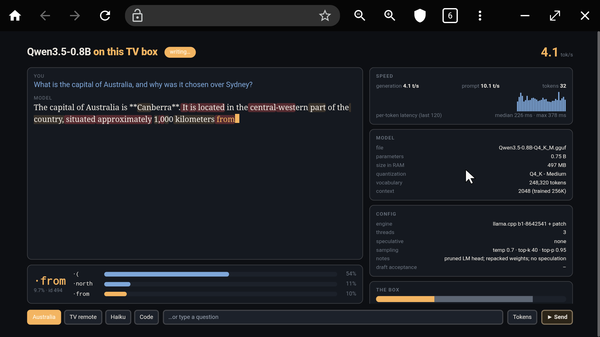

# 🤏 smolmaxxing

<p align="center"></p>

**Every device around you is more capable than it looks.** TV boxes, old phones, single-board computers and routers all ship with CPUs, RAM and flash that sit idle most of the day. **smolmaxxing** is about unlocking that capability: finding the biggest language model each device can really run, then pushing it further with custom kernels, smarter memory use and weight streaming. Every claim is measured on the hardware itself.

**Device #1 is a Xiaomi TV Box S (3rd Gen)**: Amlogic S7D, 4× Cortex-A55 @ 2.5 GHz, **1.9 GB of RAM** (about 1 GB usable), eMMC flash, Android 14, no root. On it, this repo runs models from 260 K to 9 B parameters:
- **Qwen3.5-0.8B: 16.8 tok/s** (2.2× the stock 7.5; measured in the evening of 11-05, see §17).
- **Qwen3.5-2B: 7.7 tok/s** in real chat. The box's speed drifts by ~10 % over a day, so every step is measured back to back: §16 gave +11 %, §17 another +7 %.
- **A 1-bit 8B model: 1.2 tok/s.**
- **A 9B model: 0.27 tok/s**, streaming most of its weights from flash.

Every step is written up experiment by experiment in **[`EXPERIMENT.md`](EXPERIMENT.md)** (E1-E78).

<p align="center"></p>

### Devices

| Device | Status |
|---|---|
| Xiaomi TV Box S (3rd Gen): Amlogic S7D, Cortex-A55, 2 GB | ✅ done: 260K → 9B parameters |
| More TV boxes, phones, single-board computers, routers… | 🔜 coming soon |

The techniques aren't tied to this box. Any ARM chip with dotprod gets the kernels, and any Linux or Android device with more model than RAM can use the streaming engine.

## Results on device #1

Quality is English perplexity on a fixed 22 KB text, converted to **bits per byte** so models with different tokenizers compare fairly (lower is better). Speed is generation on the TV, measured either through llama-server with real chat requests ("chat") or with llama-bench ("bench").

| Model | Size on the box | Quality (bits/byte) | Generation | Prompt | Notes |
|---|---|---|---|---|---|
| stories260K (llama2.c) | 1 MB | n/a | ~650 tok/s | n/a | the first thing that ran (§1-8) |
| Gemma 3 270M Q4_K_M | 253 MB | n/a | 22 tok/s | 73 tok/s | |
| Qwen3.5-0.8B Q4_K_M (stock) | 497 MB | n/a | 7.5 bench | 28 tok/s | |
| **Qwen3.5-0.8B, all-Q4_K + 65K head** | 442 MiB (566 MB RSS) | ≈1.00* | **16.8 bench** | 33 tok/s | best speed for its quality so far (§15-17) |
| **Qwen3.5-2B, all-Q4_K + 65K head** | 0.99 GB | **0.909** | **7.7 chat** | 17.8 | **the default: best overall** (§11, §16, §17) |
| **Ternary-Bonsai-4B, merged scales + 2-bit fields** | 1.03 GB | ≈0.965 | **4.3 chat** (4.8 bench) | 9.6 | best 4B: was 3.2 chat / 7.0 prompt on the same build (§18) |
| Bonsai-8B, 1-bit + compact scales | 0.84 GB + 0.12 GB streamed | 0.991 | **1.21 chat** (2.2 bench) | 4.9 | §14 |
| Ternary-Bonsai-8B | 0.89 GB + 0.80 GB streamed | 0.919 | 0.31 bench | 3.45 | §14 |
| Qwen3.5-9B UD-IQ2_XXS + MTP | 0.63 GB + 1.6 GB streamed | **0.885** | 0.16 chat, **0.27 with MTP** | 0.8 | best quality; flash-bound (§14) |

\* measured on the pruned head's positions (1.3 % of tokens fall outside it), so not exactly comparable; the stock full-vocabulary Q4_0 file scores 1.024.

**Other small models, stock files** (screening, §15 E54):

| Model | Generation (bench) | Prompt | Bits/byte |
|---|---|---|---|
| LFM2.5-350M (QAD Q4_0) | 23.7 tok/s | 104 tok/s | 1.805 |
| LFM2-700M (Q4_0) | 11.5 tok/s | 52.8 tok/s | 1.169 |
| Qwen3-0.6B (Q8_0) | 9.35 tok/s | 50.6 tok/s | 1.059 |
| LFM2.5-1.2B (QAD Q4_0) | 8.3 tok/s | 31.6 tok/s | 1.133 |
| Llama 3.2 1B (Q4_0) | 7.0 tok/s | 29.5 tok/s | 0.998 |
| Ternary-Bonsai-2-2B (Q2_0) | 5.9 tok/s | 15.8 tok/s | 1.124 |
| Gemma 3 1B (Q4_K_M) | 5.7 tok/s | 11.1 tok/s | 1.260 |
| Granite 4.0 H 1B (Q4_0, ~1.5 B) | too big as shipped | | **0.916** |
| ↳ rebuilt: all-Q4_K, Q8_0 embedding, 48K head (E62) | 5.29 tok/s (fits only after freeing RAM, 950 MB RSS) | | 0.919 |
| LFM3-1.7B (QAD Q4_0) | doesn't fit | | |

Granite 4.0 H 1B was the one model close to the 2B's quality. Rebuilt our way (E62), it runs at 5.29 tok/s, below the 2B's 6.55 at slightly lower quality: it carries about twice the 0.8B's weight bytes per token.

**Physics of the box:** one process can hold ~0.96 GB before Android starts killing things, and flash reads top out at **278 MB/s**. A model that has to stream X MB per token can never beat 278 / X tokens per second. That, not the CPU, is what limits everything above 2B.

## What's in here

**Kernels for Cortex-A55 (ARMv8.2 dotprod, no i8mm)**, as a patch on llama.cpp v0.8.0, each with an exactness test against a scalar reference:

| Kernel | Before → after | Where |
|---|---|---|
| Q2_K, repacked 8 rows × 4 bytes for `vdotq_laneq` (upstream repacks Q2_K only on x86 / RISC-V) | 7.8 → 13.9 G weights/s; generation +41 %, prompt 2.4× | E34 |
| TQ1_0 / TQ2_0 ternary, repacked | 9.5 → 14.4 / 11.9 → 19.1 G weights/s | E38 |
| Ternary Q2_0 → **lossless 1.875 bits/weight** in RAM (base-3 packing that keeps the per-64 scales) | Ternary-Bonsai-4B from "thrashes" to 3.2 tok/s | E39, E42 |
| **Q1_0 bit planes**: `vtst` turns a bit plane straight into a mask for `vdot`, no table lookups; **8-bit row-affine scales** (−5.6 %, 0.07 % error) | Bonsai-4B 3.02 → 4.22 tok/s; Bonsai-8B fits in 0.96 GB | E44, E52 |
| Fused Gated-DeltaNet step with direct state write (Qwen3.5) | 2B 6.0 → 6.3-6.7 tok/s | E28 |
| DeltaNet state **read in place by id** instead of a 1 MB/layer gather every token; **fp16 state** (`LLAMA_STATE_F16=1`, on by default in the UI) | 0.8B 11.9 → 12.9 tok/s; 2B +2.5 % for +0.15 % perplexity | E56, E61, E65 |
| **The LM head on the fast kernel**: the 65,668-row head was never repacked (ggml repacks only row counts divisible by 8), so 4 token rows were added; embedding rows are then rebuilt from the repacked head (inverse 8-row interleave) instead of read from flash; the one-token DeltaNet conv step fused from 4 nodes into one NEON op | 2B +7 % (bench and chat); 0.8B +9.5 % | E69-E72 |
| **Ternary weights in 2-bit fields, with scales merged per 128**: on the in-order A55, one base-3 digit costs ~5 NEON ops per 16 weights and a 2-bit field costs 2, so spending 13 % more RAM buys speed. Merging adjacent scales costs +0.18 % perplexity | Ternary-Bonsai-4B 3.2 → 4.3 tok/s in chat, prompt 7.0 → 9.6 | E76, E77 |
| **Guided matmul scheduling**: each thread grabs remaining / (2 × threads) rows, so a slow or preempted thread leaves a short tail instead of ~28 ms per token of idle cores; **single-row element-wise ops split by columns** (ggml left them all on thread 0) | 2B 6.26 → 6.54 tok/s; 0.8B +1.4 % | E63, E64 |

**Memory tricks:**
- **Pruned LM head:** keep only the ~49-66 K most useful vocabulary rows, chosen by token frequency on English, code and 7 other languages. The other logits are scattered to −inf. Saves 0.2-0.5 GB and misses ~1 % of English tokens.
- **Repack cache on flash** (`GGML_REPACK_CACHE`): repacked weights are written to a file once and mapped afterwards. Models load in seconds.

**Weight streaming for models bigger than RAM** (`ggml-cpu/stream-tv.inc`):
- **What stays in RAM:** a chosen part of the weights stays resident. The rest lives in "stream zones".
- **Prefetch:** a hook on every matmul records the order the weights are used. Reader threads then fetch zone weights ahead of time with parallel 8 MB `O_DIRECT` reads straight into the weights' own addresses, at the flash's full 278 MB/s.
- **Correctness:** every compute thread waits until its weight is completely loaded, so a wrong prediction costs time, never correctness.
- **Drop-behind:** each zone weight is freed right after use.
- **Verify mode:** `GGML_STREAM_VERIFY=1` compares every streamed tensor with the file. It found two silent-corruption bugs, which are fixed and documented in E48 and E50.
- **Speculative decoding:** with the model's own MTP head, verifying 2 tokens costs about one pass over the weights when the pass is flash-bound, so it pays off (+69 %). On the in-RAM 2B it lost (E31).

**Profiling** (env switches in the patch): `GGML_OPPROF=1` per-op table, `GGML_OPPROF=2` a node-by-node, per-thread trace of one graph (`tools/optrace.py`), `LLAMA_UBATCH_PROF` / `GGML_CPU_PROF` phase timings. They showed where a small model's time really goes (E57): ~71 % Q4_K matmuls, and only ~2 ms per token of barriers and scheduling.

**Tooling:**
- **Streaming GGUF rewriter:** adds a pruned head, extra tensors and metadata in one sequential pass, so Hugging Face → Mac → TV pipelines never store the model on the Mac.
- **MTP fetcher:** range-reads only the MTP tensors from safetensors.
- **Memory guard:** wraps every heavy run on the TV.
- **Benchmark and perplexity harnesses**, a model screener that streams any Hugging Face GGUF to the TV and scores it (`tools/screen-small.sh`), and a live token-stream web UI.

## Quick start

You need: the TV box (or another ARMv8.2 Android device) with network ADB, `adb`, `zig` (for static aarch64 musl builds), `cmake` + `ninja`, `python3`, and `uv` (for numpy).

```sh
export ADB_SERIAL=<tv-ip>:5555          # every script talks to the box through this
adb connect $ADB_SERIAL

# 1. llama.cpp v0.8.0 + the patch, cross-compiled for the TV
git clone https://github.com/ggml-org/llama.cpp third_party/llama.cpp
cd third_party/llama.cpp && git checkout 8642541 && git apply ../../patches/llama.cpp-v0.8.0-tvbox.patch
cmake -S . -B build-tv -G Ninja -DCMAKE_SYSTEM_NAME=Linux -DCMAKE_SYSTEM_PROCESSOR=aarch64 \
  -DCMAKE_C_COMPILER=$PWD/../../zigcc/cc -DCMAKE_CXX_COMPILER=$PWD/../../zigcc/c++ -DCMAKE_BUILD_TYPE=Release \
  -DCMAKE_EXE_LINKER_FLAGS=-static -DBUILD_SHARED_LIBS=OFF -DGGML_NATIVE=OFF \
  -DGGML_CPU_ARM_ARCH=armv8.2-a+dotprod+fp16 -DGGML_OPENMP=OFF -DLLAMA_OPENSSL=OFF -DLLAMA_BUILD_TESTS=OFF
ninja -C build-tv llama-server llama-cli llama-bench llama-perplexity llama-quantize
cd ../..
adb -s $ADB_SERIAL shell mkdir -p /data/local/tmp/llm/patched25 /data/local/tmp/llm/patched
adb -s $ADB_SERIAL push third_party/llama.cpp/build-tv/bin/llama-{server,cli,bench,perplexity} /data/local/tmp/llm/patched25/
adb -s $ADB_SERIAL push third_party/llama.cpp/build-tv/bin/llama-quantize /data/local/tmp/llm/patched/   # used by tools/tv-quant.sh
zig cc -target aarch64-linux-musl -O2 -static -o gguf_recut tools/gguf-recut/gguf_recut.c && adb -s $ADB_SERIAL push gguf_recut /data/local/tmp/llm/

# 2. models: rebuilt from their Hugging Face sources straight onto the TV (see below)
tools/rebuild-models.sh 2b          # also: 4b b8 tb8 q9 caches

# 3. the live chat page (default: the 2B on patched25 with fp16 state), then open http://<tv-ip>:8090 from any device on the network
tv-llm-ui/start.sh
tv-llm-ui/start.sh stop
```

**Other models:**
```sh
# Qwen3.5-0.8B, ~16 tok/s (first: `tools/rebuild-models.sh 08`, needs a native Mac build of llama-quantize)
MODEL=q08-q4k-h65p8.gguf tv-llm-ui/start.sh
# The 8B / 9B numbers below were measured with the build of that time (patched16); the current build has the same
# code plus §15-17. GGML_CHUNK_GUIDED=0 in SENV restores the old matmul scheduling. No fp16 state with MTP.
# Bonsai-8B 1-bit, ~1.2 tok/s (first run: `tools/rebuild-models.sh b8 caches`)
MODEL=b8-q1-hml.gguf BIN=patched25 EXTRA="-ctk q8_0 -ctv q8_0 -fa on -cram 0" \
  SENV="GGML_REPACK_CACHE=/data/local/tmp/llm/cache/b8c GGML_REPACK_RESIDENT_MB=800 GGML_STREAM_MODE=cache GGML_STREAM_WINDOW_MB=64" tv-llm-ui/start.sh
# Qwen3.5-9B with MTP, ~0.27 tok/s
MODEL=q9-iq2-h65-mtp.gguf BIN=patched25 EXTRA="-nr -ctxcp 0 -cram 0 -ub 16 -b 64 --spec-type draft-mtp --spec-draft-n-max 1" \
  SENV="LLAMA_STREAM_RESIDENT_MB=600 LLAMA_STREAM_PIN=output.,blk.32. GGML_STREAM_WINDOW_MB=64" tv-llm-ui/start.sh
```

Everything on the box lives in `/data/local/tmp/llm` and runs as the adb `shell` user. None of it changes system settings. `adb shell rm -rf /data/local/tmp/llm` removes it all.

## Model files: not in git, rebuildable

The model files (0.5-4 GB each) are not in this repo. [`tools/rebuild-models.sh`](tools/rebuild-models.sh) recreates every one from public Hugging Face files, streaming them through `tools/gguf_build.py` onto the TV. The SHA-256s below are of the files used in the experiments. Rebuilds of the 4B, Bonsai-8B and 9B files were checked **byte-identical**.

| File on the TV | Target | Built from | SHA-256 |
|---|---|---|---|
| `w-q4k-h65.gguf` (Qwen3.5-2B) | `2b` | `unsloth/Qwen3.5-2B-GGUF` BF16 + `imatrix_unsloth`, MTP block from `Qwen/Qwen3.5-2B`, quantized on the TV, head `data/head-ids-ml60k.txt` | `16057be3…3285b` |
| `w-q4k-h65p8.gguf` (Qwen3.5-2B, **default**) | `2b` | the file above re-cut on the TV with `data/head-ids-ml60k-p8.txt` (65,672 rows, so the head is repacked, §17) | `631a27ae…54fd11` |
| `w-q4k-h45.gguf` (option) | `2b45` | the same, 45,654-row head `data/head-ids-ml40k.txt` (byte-identical to E29's H45 file) | `a50eadc5…664d5b` |
| `q08-q4k-h65.gguf` (Qwen3.5-0.8B) | `08` | `unsloth/Qwen3.5-0.8B-GGUF` BF16 + its `imatrix_unsloth`, pure Q4_K, head `data/head-ids-ml60k.txt`, quantized on the Mac | `901f3838…8523a6b` |
| `q08-q4k-h65p8.gguf` | `08` | the file above re-cut on the Mac with `data/head-ids-ml60k-p8.txt` (§17) | `7dd2aac5…52fc232` |
| `tb4-q20-hml.gguf` | `4b` | `prism-ml/Ternary-Bonsai-4B-gguf` Q2_0_g64, head `data/head-ids-qwen3-ml64k.txt` | `a02d805f…3fe24` |
| `b8-q1-hml.gguf` | `b8` | `prism-ml/Bonsai-8B-gguf` Q1_0, same head | `fc297cb3…0d42a` |
| `tb8-q20-hml.gguf` | `tb8` | `prism-ml/Ternary-Bonsai-8B-gguf` Q2_0_g64, same head | `01b1e0ef…93e06` |
| `q9-iq2-h65-mtp.gguf` | `q9` | `unsloth/Qwen3.5-9B-GGUF` UD-IQ2_XXS, MTP block from `Qwen/Qwen3.5-9B` (Q4_0), 65K head | `7766478e…8dcbc` |
| `cache/b8c.*`, `cache/tb8.*` | `caches` | written by the first run with `GGML_REPACK_CACHE` | |

The head-id lists in `data/` were made by `tools/vocab_select.py` (Qwen3.5 tokenizer) and `tools/head_select_tok.py` (any tokenizer, via `llama-tokenize`), from the corpus `tools/fetch_corpus.py` downloads (Wikipedia + Project Gutenberg).

## Layout

| Path | What |
|---|---|
| [`EXPERIMENT.md`](EXPERIMENT.md) | the full write-up: §1-8 the first tiny model, §9-10 llama.cpp and the first flash streaming, §11 the 2B push, §13 the 4B push, §14 the 9B push, §15 the 0.8B speed push, §16-17 the 2B rounds 3-4, §18 the 4B round 2 (arXiv / GitHub scan, 2-bit ternary layouts) |
| `patches/llama.cpp-v0.8.0-tvbox.patch` | every change to llama.cpp: pruned head (`output_ids`) for Qwen3 / Qwen3.5 / Granite 4.0 H, the kernels above (`ggml-cpu/repack-*-tv.inc`), fused DeltaNet (state read by id, optional fp16 state, one-token conv step), embedding rows from the resident head, repack cache and streaming engine (`ggml-cpu/stream-tv.inc`, loader hooks), padded small batches, op profiler, pruned-head-aware perplexity, Vulkan tuning for Mali |
| `tools/` | GGUF rewriter / head pruner / re-cutter, vocabulary selection, corpus and MTP fetchers, model rebuild script, TV memory guard and RAM helper, benchmark sweeps, kernel benches and exactness checks (`kbench/`), flash benchmark |
| `tv-llm-ui/` | the live token-stream page for llama-server (confidence colours, top-3 alternatives, speed, box stats), its launcher and the benchmark harness |
| `tiny-llm-web/` | the llama2.c story server + TV page from the first experiment |
| `bench/` | `results.jsonl` (every chat benchmark: prompts, outputs, speeds) and `raw/` (logs of every experiment) |
| `data/` | head-id lists and the two evaluation texts |
| `zigcc/` | zig wrappers for cross-compiling static aarch64 binaries |
| `screenshots/` | the web pages running on the TV |

## Lessons

- **On this box the 2B at 4 bits beats every bigger model at 1-2 bits.** Post-training quantization below ~2.5 bits breaks normal models (E22, E23, E35). Models trained for 1-bit or ternary hold up, but at 4-8 B they don't fit without streaming.
- **Past RAM, flash bandwidth sets the speed.** The kernel's LRU is the worst possible policy for a cyclic scan bigger than the cache: it re-reads everything every token. Keep a fixed resident set and stream the rest yourself.
- **Batching is free when you are flash-bound.** Prompts and speculative verification cost about one weight pass, whatever their size.
- **Measure, then verify.** Two streaming bugs gave plausible speeds and wrong numbers; only comparing tensors with the file, and perplexity with a Mac reference, caught them.
- **Small models are mostly vocabulary.** Qwen3.5-0.8B's 248K-row head is a third of its weights; pruning it to 65K rows plus all-Q4_K took it from 7.5 to 12.1 tok/s (E55). Small models also lose more to 4 bits (+7 % perplexity vs +2.3 % for the 2B).
- **Simulate before you write a kernel.** Activation sparsity (E58) and a low-rank head (E60) both looked promising on paper; a quality simulation on the Mac killed each in under an hour.
- **On an in-order core, count NEON ops as well as bytes.** Tighter packing saved 20 % of the bytes and cost 2.5× the ops; undoing it made the 4B 33 % faster in chat (E76, E77). The 4-bit kernel is the opposite case, limited by RAM (E27), so the trick does not help the 2B or 0.8B.
- **Check that every big matrix reaches the fast kernel.** The 2B's head (65,668 rows, ~10 % of each token's weights) silently ran on the generic kernel for weeks because ggml only repacks row counts divisible by 8; four extra rows gave +5.8 % (E71, E72). The load log's repack buffer size gives it away.
- **Guard the box.** After two early kernel panics, every heavy run goes through a wrapper that kills it below 180 MB of free memory.

## License

[MIT](LICENSE). The llama.cpp patch is a derivative of [llama.cpp](https://github.com/ggml-org/llama.cpp) (MIT). Model weights keep their own licenses, and the evaluation texts are Wikipedia excerpts (CC BY-SA 4.0).

## Credits

Built on [llama.cpp](https://github.com/ggml-org/llama.cpp) and [llama2.c](https://github.com/karpathy/llama2.c). Models from [Qwen](https://huggingface.co/Qwen), [unsloth](https://huggingface.co/unsloth) (GGUFs and importance matrices), [PrismML](https://huggingface.co/prism-ml) (Bonsai), Google (Gemma) and [stories260K](https://huggingface.co/karpathy/tinyllamas). The evaluation texts are excerpts from Wikipedia (CC BY-SA 4.0). The 🤏 logo is the pinching-hand emoji from Google's [Noto Emoji](https://github.com/googlefonts/noto-emoji) (Apache 2.0).
