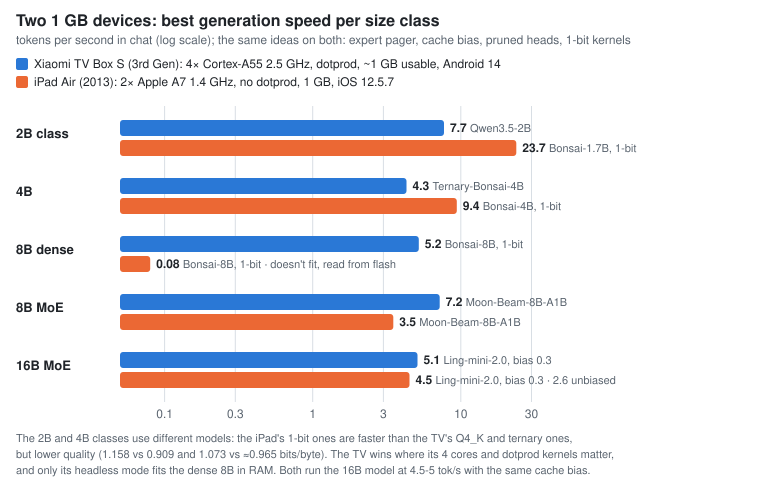
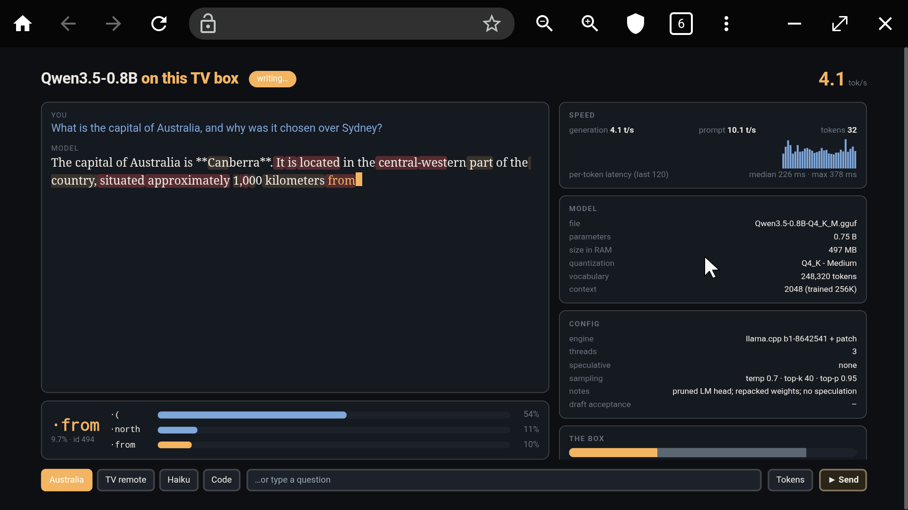

# 🤏 smolmaxxing

  

🎉 <b>Over 5,000 downloads on <a href="https://huggingface.co/hyperionaidev">Hugging Face</a></b> 🎉 
📰 Featured in <a href="https://tproger.ru/news/proekt-smolmaxxing-zapustil-model-na-80-mlrd-parametrov-na-tele">Tproger</a> and <a href="https://gigazine.net/news/20261113-smolmaxxing/">GIGAZINE</a>

**Run the biggest language model you can on the smallest hardware you own.**

TV boxes, old phones and tablets, single-board computers and routers all have a CPU, some RAM and flash storage that sit idle most of the day. smolmaxxing finds the biggest model each of them can really run, then pushes it further with custom kernels, careful memory use and weights streamed from flash. Every number in this repo was measured on the device itself.

## Eight devices so far

<table>
<tr>
<td valign="top" width="33%">
<b>📺 Xiaomi TV Box S (3rd Gen)</b> 
Amlogic S7D, 4× Cortex-A55 1.9 GB RAM (about 1 GB usable) · Android 14, no root  
Everyday: Qwen3.5-2B at <b>7.7 tok/s</b> 
Biggest: Ling-mini-2.0, 16B, at <b>5.1 tok/s</b>  
<a href="docs/tv-box.md">Full results →</a>
</td>
<td valign="top" width="33%">
<b>📱 iPad Air (2013)</b> 
Apple A7, 2 cores 1 GB RAM (about 700 MB usable) · iOS 12.5.7, jailbroken  
Everyday: Bonsai-1.7B (1-bit) at <b>24-26 tok/s</b> 
Biggest: Ling-mini-2.0, 16B, at <b>2.6-4.5 tok/s</b>  
<a href="ipad-air/README.md">Full results →</a>
</td>
<td valign="top" width="33%">
<b>📲 OnePlus Nord CE 2 (2022)</b> 
MediaTek Dimensity 900, 2× Cortex-A78 + 6× A55 7.4 GB RAM (about 3 GB free) · Android 13, no root  
Everyday: Qwen3.6-35B-A3B at <b>4.9-5.7 tok/s</b> 
Biggest: Qwen3-Next-80B-A3B at <b>2.6-3.1 tok/s</b>  
<a href="docs/phone.md">Full results →</a>
</td>
</tr>
<tr>
<td valign="top" width="33%">
<b>📺 BuzzTV XR4500</b> 
Amlogic SM1 (S905X3 class), 4× Cortex-A55, 32-bit 2 GB RAM (about 1.3 GB free) · Android 9 (32-bit), no root  
Everyday: Qwen3-0.6B (Q8_0) at <b>1.7 tok/s</b> 
Biggest: Qwen3.5-2B at <b>0.4 tok/s</b>  
<a href="docs/buzztv-xr4500.md">Full results →</a>
</td>
<td valign="top" width="33%">
<b>📖 Kindle Paperwhite 3 (2015)</b> 
NXP i.MX6 SoloLite, 1× Cortex-A9, 32-bit 512 MB RAM (about 440 MB free) · Jailbroken, own Alpine Linux userspace  
Everyday: SmolLM2-135M at <b>1.7 tok/s</b> 
Biggest: Bonsai-4B (1-bit) at <b>0.03 tok/s</b>, from flash  
<a href="docs/kindle.md">Full results →</a>
</td>
<td valign="top" width="33%">
<b>📲 Realme 5 Pro (2019)</b> 
Snapdragon 710, 2× Kryo 360 (A76-class) + 6× A55, no dotprod 6 GB RAM (about 3.3 GB free) · Android 10, no root  
Everyday: Qwen3-0.6B (Q8_0) at <b>14.6 tok/s</b> 
Biggest: Qwen3-1.7B (Q8_0) at <b>5.7 tok/s</b>  
<a href="docs/realme-5pro.md">Full results →</a>
</td>
</tr>
<tr>
<td valign="top" width="33%">
<b>📲 Samsung Galaxy S24 Ultra (2024)</b> 
Snapdragon 8 Gen 3, 1× Cortex-X4 + 5× A720 + 2× A520 12 GB RAM, 3.0 GB RSS for server + model · Android 17  
Everyday: Qwen3.6-35B-A3B at <b>12-16 tok/s</b> 
Biggest: the same 35B MoE, from the phone GGUF (12.3 GB)  
<a href="https://github.com/hyperionaidev/smolmaxxing/issues/13">Submission →</a> · <a href="https://github.com/drqebas-crypto/phone-giant">setup scripts</a> 
Submitted by <a href="https://github.com/drqebas-crypto">drqebas-crypto</a>
</td>
<td valign="top" width="33%">
<b>📲 Infinix GT 20 Pro (2024)</b> 
MediaTek Dimensity 8200 Ultimate, 1× Cortex-A78 + 3× A78 + 4× A55 8 GB RAM · XOS 16.3.0  
Everyday: Qwen3.6-35B-A3B at <b>3.1 tok/s</b> 
Biggest: the same 35B MoE, from the phone GGUF (no log yet)  
<a href="https://github.com/hyperionaidev/smolmaxxing/issues/14">Submission →</a> 
Submitted by <a href="https://github.com/kouunbliss319">kouunbliss319</a>
</td>
</tr>
</table>

The TV box and the iPad run 8B and 16B mixture-of-experts models on about 1 GB of RAM, and the phone runs 35B and 80B ones with about 3 GB free. They all keep only part of each model in memory and read the rest from flash as it's needed. The BuzzTV box, measured by a contributor, is the first 32-bit device: the same cores as the Xiaomi box, but a 32-bit Android that rules out the arm64-only kernels. The Kindle runs a chatbot and a coding assistant on one 32-bit Cortex-A9 with 512 MB of RAM. The Realme 5 Pro, also measured by a contributor, is the first device without the dot-product extension: its A76-class cores carry fp16 but not dotprod, so it runs the plain-NEON build and its numbers show what that costs. Two more contributors ran the phone's 35B mixture-of-experts on their own phones: a Galaxy S24 Ultra on a Snapdragon 8 Gen 3 at 12-16 tok/s, the fastest 35B run here ([drqebas-crypto](https://github.com/drqebas-crypto)), and an Infinix GT 20 Pro at 3.1 tok/s ([kouunbliss319](https://github.com/kouunbliss319)).

The chart below compares the two 1 GB devices size class by size class; the phone plays in a bigger league, and its results are in [docs/phone.md](docs/phone.md).

More devices (single-board computers, routers, more phones) are coming. The techniques aren't tied to one box: the 1-bit kernel needs only basic NEON, and the flash streaming works on any Linux or Android device with more model than RAM.

**Got a small device?** Run a model on it and [submit your numbers](CONTRIBUTING.md#submit-your-device): we'll add them to the results.

## How it works

All of it is a patch on [llama.cpp](https://github.com/ggml-org/llama.cpp). The main ideas:

- **Kernels built for the chip.** A 1-bit lookup-table kernel, repacked 2-bit and ternary formats for the Cortex-A55, and versions of them for the A7, which has no dot-product instructions.
- **Less RAM per model.** Most of a small model's vocabulary is rarely used, so we drop those output rows. On the TV, a "headless" mode also stops the launcher and Google services while a model runs.
- **Experts paged from flash.** A mixture-of-experts model only uses a few experts per token. We keep the popular ones in RAM, read the others from flash on demand and prefetch the next layer's. This is how 8B and 16B models run on 1 GB, and 35B and 80B models on a phone.
- **Streaming for dense models** bigger than RAM, at the flash's full speed.

[docs/how-it-works.md](docs/how-it-works.md) has every technique with its measured gain.

## Try it

The quickest start is a ready-made model file from Hugging Face. The TV box and iPad files need the patched llama.cpp (stock llama.cpp can't load their pruned heads); the phone files load anywhere, but their speeds need the patch's expert pager.

- **TV box or another ARMv8.2 Android device:** [docs/tv-box-setup.md](docs/tv-box-setup.md)
- **Chat on the TV itself, offline:** the SmolChat app starts the model server at every boot and opens the chat from the TV home screen, with no computer or internet: [docs/tv-box-setup.md](docs/tv-box-setup.md#offline-chat-on-the-tv-itself)
- **32-bit ARM (armv7) Android device:** [docs/buzztv-xr4500.md](docs/buzztv-xr4500.md#build)
- **Jailbroken iPad on iOS 12:** [ipad-air/README.md](ipad-air/README.md#run-it)
- **Android phone with 8 GB of RAM:** [Qwen3.6-35B-A3B](https://huggingface.co/hyperionaidev/Qwen3.6-35B-A3B-phone-GGUF) (12.3 GB) and [Qwen3-Next-80B-A3B](https://huggingface.co/hyperionaidev/Qwen3-Next-80B-A3B-phone-GGUF) (27.6 GB, two files), set up as in [docs/phone.md](docs/phone.md#running-it).
- **ARM device without the dot-product extension** (`asimddp` missing from `/proc/cpuinfo`): [docs/realme-5pro.md](docs/realme-5pro.md)
- **All model files and how to rebuild them:** [docs/models.md](docs/models.md)

## Read more

| Page | What's in it |
|---|---|
| [docs/tv-box.md](docs/tv-box.md) | device #1: every model run on the TV box, speed and quality |
| [ipad-air/README.md](ipad-air/README.md) | device #2: the iPad Air results, setup and scripts |
| [docs/phone.md](docs/phone.md) | device #3: the OnePlus phone, from 16B to an 80B model |
| [docs/buzztv-xr4500.md](docs/buzztv-xr4500.md) | device #4: a 32-bit Android TV box, submitted by a contributor |
| [docs/kindle.md](docs/kindle.md) | device #5: a jailbroken Kindle Paperwhite 3 on one Cortex-A9, and an fp16 fix for llama.cpp on older 32-bit Arm |
| [docs/realme-5pro.md](docs/realme-5pro.md) | device #6: an Android phone whose A76-class cores lack the dot-product extension, and what that costs |
| [docs/how-it-works.md](docs/how-it-works.md) | the kernels, memory tricks, expert pager and streaming engine |
| [docs/models.md](docs/models.md) | downloads for all three devices, rebuild targets and checksums |
| [docs/lessons.md](docs/lessons.md) | what we learned, including what didn't work |
| [EXPERIMENT.md](EXPERIMENT.md) | the full lab notebook: 171 experiments, failures included |

## What's in the repo

| Path | What |
|---|---|
| `patches/` | every change to llama.cpp for the TV box and the phone (the iPad's patch is in `ipad-air/patches/`) |
| `tools/` | model rebuilding, GGUF rewriting, benchmarks and kernel checks |
| `tv-llm-ui/` | the live token-stream chat page, its launchers, and `android/`: the SmolChat TV app that runs it offline from boot |
| `ipad-air/` | device #2: iOS 12 build, `smolchat`, deploy and benchmark scripts |
| `bench/` | every chat benchmark (`results.jsonl`) and the raw logs |
| `data/` | vocabulary lists and evaluation texts |
| `tiny-llm-web/` | the first experiment: a 260K-parameter story model |
| `zigcc/` | zig wrappers for cross-compiling static aarch64 binaries |
| `zigcc32/` | the same for 32-bit ARM (armv7) devices |
| `kindle/` | device #5: the Kindle build, the fp16 patch and the benchmark scripts |

## Similar projects

Other people running language models on hardware that was never meant for them:

| Project | Hardware | What it runs |
|---|---|---|
| [On-chip LLM on a KV260](https://www.mikeayles.com/blog/on-chip-llm-kv260/) | AMD Kria KV260 FPGA ($250) | a 3.16M-parameter INT4 transformer held entirely in on-chip memory, about 60K tok/s |
| [ps2-llm](https://github.com/xaskasdf/ps2-llm) | PlayStation 2 (294 MHz MIPS, 32 MB RAM) | a 10M-parameter instruct model |
| [iiama2.c](https://github.com/brysontang/iiama2.c) | Nintendo Wii (729 MHz PowerPC, 88 MB RAM) | llama2.c with stories15M, 61.9 tok/s on the GPU |
| [esp32-ai](https://github.com/slvDev/esp32-ai) | ESP32-S3 microcontroller | a 28.9M-parameter model at about 9.9 tok/s |
| [go-pherence](https://github.com/rcarmo/go-pherence) | CPUs with AVX2, NEON or RVV, and NVIDIA GPUs | pure-Go inference for language, speech and vision models |
| [Ryan Seddon on X](https://x.com/ryanseddon/status/2088151404024344870) | Sega Dreamcast, via Windows CE | a language model running under the Dreamcast's Windows CE |

## Star History

<a href="https://www.star-history.com/?repos=hyperionaidev%2Fsmolmaxxing&type=date&legend=top-left">
 <picture>
   <source media="(prefers-color-scheme: dark)" srcset="https://api.star-history.com/chart?repos=hyperionaidev/smolmaxxing&type=date&theme=dark&legend=top-left" />
   <source media="(prefers-color-scheme: light)" srcset="https://api.star-history.com/chart?repos=hyperionaidev/smolmaxxing&type=date&legend=top-left" />
   
 </picture>
</a>

## License

[MIT](LICENSE). The llama.cpp patches are derivatives of [llama.cpp](https://github.com/ggml-org/llama.cpp) (MIT). Model weights keep their own licenses, and the evaluation texts are Wikipedia excerpts (CC BY-SA 4.0).

## Credits

Built on [llama.cpp](https://github.com/ggml-org/llama.cpp) and [llama2.c](https://github.com/karpathy/llama2.c). Models from [Qwen](https://huggingface.co/Qwen), [unsloth](https://huggingface.co/unsloth) (GGUFs and importance matrices), [PrismML](https://huggingface.co/prism-ml) (Bonsai), [inclusionAI](https://huggingface.co/inclusionAI) (Ling-mini-2.0), [tablinum](https://huggingface.co/tablinum) (Moon-Beam), [bartowski](https://huggingface.co/bartowski) and [mradermacher](https://huggingface.co/mradermacher) (GGUFs), Google (Gemma) and [stories260K](https://huggingface.co/karpathy/tinyllamas). The iPad is jailbroken with [Amethyst](https://github.com/staturnzz/amethyst). The banner uses [Archivo](https://fonts.google.com/specimen/Archivo) (SIL OFL) and is rendered by `tools/banner/render.sh`. The 🤏 logo is the pinching-hand emoji from Google's [Noto Emoji](https://github.com/googlefonts/noto-emoji) (Apache 2.0).
