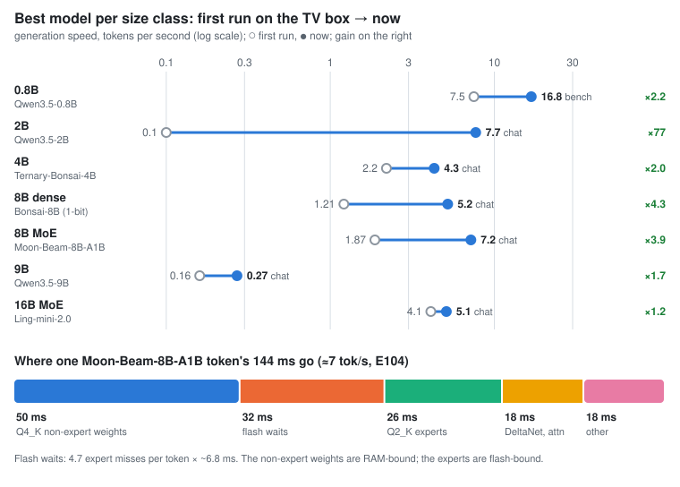

# 📺 Device #1: Xiaomi TV Box S (3rd Gen)

Amlogic S7D, 4× Cortex-A55 at 2.5 GHz, **1.9 GB of RAM** (about 1 GB usable), eMMC flash, Android 14, no root. Everything runs on the CPU as the adb `shell` user.

[← back to the main README](../README.md) · [setup](tv-box-setup.md) · [how it works](how-it-works.md) · [downloads](models.md)

## At a glance

On this box, the repo runs models from 260 K to 16 B parameters:

- **Qwen3.5-2B: 7.7 tok/s** in real chat. The best balance of speed and quality, and the default.
- **Qwen3.5-0.8B: 16.8 tok/s**, 2.2× the stock file's 7.5.
- **Moon-Beam-8B-A1B, an 8B mixture of experts: 7.2 tok/s**, with its experts paged from flash on demand.
- **Bonsai-8B, a dense 1-bit 8B model: 5.2 tok/s**, up from 1.2, fully in RAM.
- **Ling-mini-2.0, a 16B mixture of experts: 5.1 tok/s**, coherent over 600-word answers.
- **Qwen3.5-9B, dense: 0.27 tok/s**, streaming most of its weights from flash.

The box's speed drifts by about 10 % over a day, so every change was measured back to back against the one before it.

## Scoreboard

| Class | Best model | First run → now (tok/s) | Gain | Bits/byte | What got it there |
|---|---|---|---|---|---|
| 0.8B | Qwen3.5-0.8B | 7.5 → **16.8** bench | ×2.2 | ≈1.00 | all-Q4_K, padded 65K head, fp16 DeltaNet state |
| 2B | Qwen3.5-2B | 0.1 → **7.7** chat | ×77 | 0.909 | all-Q4_K, padded 65K head, fused DeltaNet |
| 4B | Ternary-Bonsai-4B | 2.2 → **4.3** chat | ×2.0 | ≈0.965 | ternary weights in 2-bit fields, merged scales |
| 8B dense | Bonsai-8B (1-bit) | 1.21 → **5.2** chat | ×4.3 | 0.974 | 1-bit LUT kernel, fully resident in headless mode |
| 8B MoE | Moon-Beam-8B-A1B | 1.87 → **7.2** chat | ×3.9 | 0.996 | Q2_K experts paged from flash, cache-aware routing, prefetch |
| 9B | Qwen3.5-9B | 0.16 → **0.27** chat | ×1.7 | **0.885** | weight streaming plus its own MTP head |
| 16B MoE | Ling-mini-2.0 | 4.1 → **5.1** chat | ×1.2 | 1.054 | the Moon-Beam recipe, unchanged |

What "first run" means for each row

- **0.8B:** the stock Q4_K_M file.
- **2B:** the stock file, streamed from flash because it didn't fit in RAM. Its first build that fit ran at 4.8, so from there the gain is ×1.6.
- **4B:** the stock file, which thrashed.
- **8B dense:** the last 0.1 GB streamed from flash.
- **8B MoE:** the first expert-pager run, without routing bias.
- **9B:** streamed.
- **16B:** started on the Moon-Beam recipe, so its gain is small.

Bigger isn't automatically better. Ling-mini-2.0 is twice Moon-Beam's size, but it scores worse per byte and runs slower.

## Every model we ran

Quality is English perplexity on a fixed 22 KB text, converted to **bits per byte** so models with different tokenizers compare fairly (lower is better). "Chat" speeds come from real chat requests through llama-server, "bench" from llama-bench.

| Model | Size on the box | Quality (bits/byte) | Generation | Prompt | Notes |
|---|---|---|---|---|---|
| stories260K (llama2.c) | 1 MB | n/a | ~650 tok/s | n/a | the first thing that ran (§1-8) |
| Gemma 3 270M Q4_K_M | 253 MB | n/a | 22 tok/s | 73 tok/s | |
| Qwen3.5-0.8B Q4_K_M (stock) | 497 MB | n/a | 7.5 bench | 28 tok/s | |
| **Qwen3.5-0.8B, all-Q4_K + 65K head** | 442 MiB (566 MB RSS) | ≈1.00* | **16.8 bench** | 33 tok/s | best speed for its quality (§15-17) |
| **Qwen3.5-2B, all-Q4_K + 65K head** | 0.99 GB | **0.909** | **7.7 chat** | 17.8 | **the default: best overall** (§11, §16, §17) |
| **Ternary-Bonsai-4B, merged scales + 2-bit fields** | 1.03 GB | ≈0.965 | **4.3 chat** (4.8 bench) | 9.6 | best 4B: was 3.2 chat / 7.0 prompt on the same build (§18) |
| **Moon-Beam-8B-A1B (MoE), Q2_K experts + 60K head** | 0.48 GB GGUF + 2.6 GB repack cache on flash, ~1.1 GB RSS | 0.996 | **7.2 chat** | n/a | **fastest 8B**: 128 experts, 6 used; expert pager, cache-aware routing, prefetch, repeat penalty (§19, headless mode) |
| **Ling-mini-2.0 (MoE, 16.3 B), Q2_K experts + 60K head** | 0.47 GB GGUF + 5.3 GB repack cache on flash, ~1.13 GB RSS | 1.054 | **5.1 chat** | n/a | **biggest model at a usable speed**: 256 experts of 1 MB, 8 used, pool 43 per layer, bias 0.3 (§20) |
| **Bonsai-8B, 1-bit, LUT kernel** | 0.96 GB, all resident | 0.991 (0.974 on the head) | **5.2 chat** (5.1-5.4 bench), 4.0 at ~900 tokens of context | 5.8-6.1 | best dense 8B: headless mode, Q8_0 attention (§19) |
| Bonsai-8B, 1-bit + compact scales | 0.84 GB + 0.12 GB streamed | 0.991 | 1.21 chat (2.2 bench) | 4.9 | §14, before headless mode |
| Ternary-Bonsai-8B | 0.89 GB + 0.80 GB streamed | 0.919 | 0.31 bench | 3.45 | §14 |
| Qwen3.5-9B UD-IQ2_XXS + MTP | 0.63 GB + 1.6 GB streamed | **0.885** | 0.16 chat, **0.27 with MTP** | 0.8 | best quality; flash-bound (§14) |

\* Measured on the pruned head's positions (1.3 % of tokens fall outside it), so not exactly comparable. The stock full-vocabulary Q4_0 file scores 1.024.

Other small models we screened (stock files, §15 E54)

| Model | Generation (bench) | Prompt | Bits/byte |
|---|---|---|---|
| LFM2.5-350M (QAD Q4_0) | 23.7 tok/s | 104 tok/s | 1.805 |
| LFM2-700M (Q4_0) | 11.5 tok/s | 52.8 tok/s | 1.169 |
| Qwen3-0.6B (Q8_0) | 9.35 tok/s | 50.6 tok/s | 1.059 |
| LFM2.5-1.2B (QAD Q4_0) | 8.3 tok/s | 31.6 tok/s | 1.133 |
| Llama 3.2 1B (Q4_0) | 7.0 tok/s | 29.5 tok/s | 0.998 |
| Ternary-Bonsai-2-2B (Q2_0) | 5.9 tok/s | 15.8 tok/s | 1.124 |
| Gemma 3 1B (Q4_K_M) | 5.7 tok/s | 11.1 tok/s | 1.260 |
| Granite 4.0 H 1B (Q4_0, ~1.5 B) | too big as shipped | | **0.916** |
| ↳ rebuilt: all-Q4_K, Q8_0 embedding, 48K head (E62) | 5.29 tok/s (fits only after freeing RAM, 950 MB RSS) | | 0.919 |
| LFM3-1.7B (QAD Q4_0) | doesn't fit | | |

Granite 4.0 H 1B was the one model close to the 2B's quality. Rebuilt our way (E62), it runs at 5.29 tok/s, below the 2B's 6.55 at slightly lower quality: it carries about twice the 0.8B's weight bytes per token.

## What limits this box

**RAM.** One process can hold about 0.96 GB before Android starts killing things, or about 1.15 GB in headless mode, with the launchers and Google services stopped.

**Flash.** Reads top out at **278 MB/s**, and a lone ~1 MB random read costs about 6 ms. A model that has to stream X MB per token can never beat 278 / X tokens per second. That, not the CPU, is what limits everything above 2B, and it's why a mixture-of-experts model, which touches about 1 B of its 8 B weights per token, is the way past it.

**Could an 8B model reach 10 tok/s?** We measured it (E98). Moon-Beam reaches 10.4 tok/s with 2 experts per token, but the text turns to gibberish; the best coherent setting is about 7-8 tok/s. A dense Qwen3-8B is Bonsai-8B at 1 bit, and the smallest Qwen MoE (35B-A3B) touches 3× Moon-Beam's weights per token.

## What we built, by bottleneck

Each item is explained, with its numbers, in [how-it-works.md](how-it-works.md).

| Bottleneck | Innovations | Biggest wins |
|---|---|---|
| **Compute** (in-order A55, 10 items) | Q2_K and ternary repacks for `vdotq_laneq`, 1-bit bit planes, a 1-bit lookup-table kernel, ternary in 2-bit fields, Q8_0 attention with a skip threshold, fused Gated-DeltaNet, DeltaNet state read by id / fp16, the LM head on the fast kernel, guided matmul scheduling | Q2_K 7.8 → 13.9 G weights/s; Bonsai-8B 3.77 → 5.1-5.4; 4B 3.2 → 4.3; long answers no longer halve the speed |
| **RAM** (~1 GB, 5 items) | pruned LM head, lossless 1.875-bit ternary, headless mode, a fork-free memory guard, a repack cache on flash | −0.2 to −0.5 GB per model; free RAM ~1,000 → ~1,300 MB; Bonsai-8B 1.2 → 3.6 before any kernel work |
| **Flash** (278 MB/s, 5 items) | weight streaming with O_DIRECT, MTP speculation when flash-bound, expert pager, cache-aware routing, pre-gated prefetch | 9B +69 %; expert misses 13 % → ~2 %; Moon-Beam 4.4 → 7.2 |
| **Output quality** (2 items) | a long-answer degeneration test, a repeat penalty of 1.15 over 256 tokens | degenerate long answers 12/13 → 1/13 |

The full story, experiment by experiment, is §1-20 of [EXPERIMENT.md](../EXPERIMENT.md).
