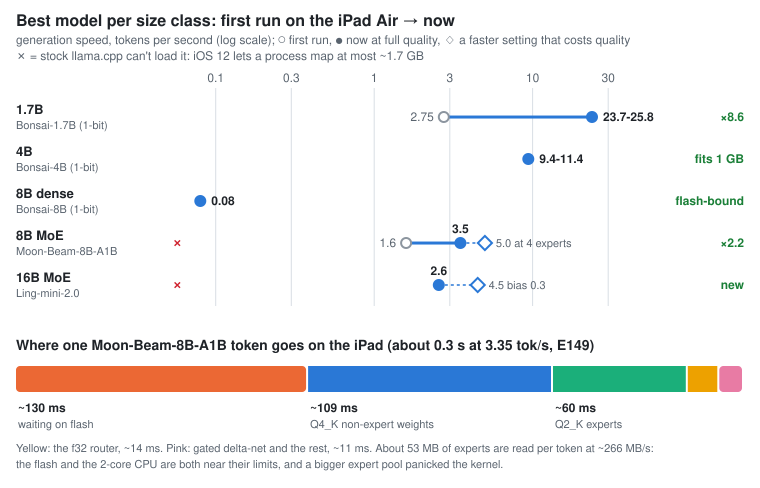
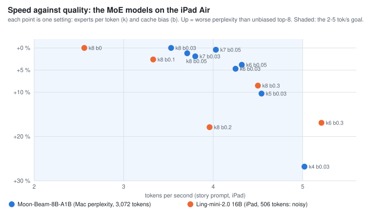

# 📱 Device #2: iPad Air (2013)

llama.cpp, running locally on a first-generation iPad Air: Apple A7 (2 cores, NEON without dotprod), **1 GB of RAM**, iOS 12.5.7, jailbroken with [Amethyst](https://github.com/staturnzz/amethyst), CPU only. Models are cross-compiled from a Mac and chatted with in a terminal or in the iPad's own Safari. The full write-up, including what failed, is §21 of [`EXPERIMENT.md`](../EXPERIMENT.md).

[← back to the main README](../README.md) · [downloads](../docs/models.md#ipad-air) · [lessons](../docs/lessons.md)

## At a glance

A 13-year-old tablet runs:

- **Bonsai-1.7B (1-bit) at 24-26 tok/s**, 18-22 in long chats. The everyday model: it answers well and writes correct code.
- **Bonsai-4B (1-bit) at about 10 tok/s**, with a 512-token context to stay inside memory.
- **Moon-Beam-8B-A1B, an 8B mixture of experts, at about 3.5 tok/s**, or 5 with half its experts, at a quality cost.
- **Ling-mini-2.0, a 16B mixture of experts, at 2.6-4.5 tok/s**, depending on how much quality you trade.

The 8B and 16B models are bigger than iOS lets a process even map, so their experts are read from flash as they're needed.

<p align="center"></p>

## Results

Every speed uses 2 threads and a 1,024-token context (512 where noted), through `smolchat` on a fixed three-turn conversation. The ranges are across those turns.

| Model | File | Generation (tok/s) | Prompt (tok/s) | Peak RSS | Three-question test |
|---|---|---|---|---|---|
| **Bonsai-1.7B Q1_0 (1-bit)** | 237 MiB | **23.7-25.8**, 18-22 through long chats | 29-33 (first prompt about 7) | 605 MB | **all three right, and writes correct code: the one to use** |
| Bonsai-4B Q1_0 (1-bit), `-c 512 -b 64` | 546 MiB | 9.4-11.4, 9.2-10.3 through long chats | 11-14 (first about 3.5) | 615-682 MB | right on France, tides mostly right, fails recall every run; better per byte (1.073 vs 1.158 bits/byte) |
| Moon-Beam-8B-A1B (MoE), expert pager, `-c 512 -b 64` | 2.6 GiB, 474 MB mapped | 3.5-3.6 on longer answers; 4.9-5.1 with `--experts 4` (+27 % perplexity) | 4.2-4.3 | 600-625 MB | all three right |
| Ling-mini-2.0 (16.3B MoE, 1.4B active), expert pager, `-c 512 -b 64` | 5.2 GiB, 466 MB mapped | 2.6 unbiased; 3.3 with bias 0.1 (+2.6 % perplexity); 4.4-4.6 with bias 0.3; 5.2 adding `--experts 6` | 2.8-3.6 | 556-576 MB | not run; +3 % perplexity vs Moon-Beam |
| SmolLM2-360M-Instruct Q4_K_M | 258 MiB | 10.9-12.5 | 18-20 | 269-316 MB | all three right; the lightest good option |
| Gemma 3 270M-it Q4_K_M | 241 MiB | 15.4-19.0 | 45-64 | 248-294 MB | wrong on tides, empty reply on recall |
| SmolLM2-135M-Instruct Q4_K_M | 101 MB | 18.6-29.3 | 42-52 | 141 MB | right on France and recall, weak on tides |
| Qwen3.5-0.8B Q4_K_M | 508 MiB | about 0.2 | n/a | 506 MB | thrashes the page cache, stopped by hand |

Only the Bonsai, Moon-Beam and Ling rows were measured on the latest build; the others predate the attention and sampler work. `stories15M-q4_0` (18 MB) reaches about 290 tok/s in `llama-simple`. The 8B and 16B models are for chat sessions, not the always-on server: iOS's memory watchdog resets even the 4B server within minutes, so serve the 1.7B.

## How it got fast

### Bonsai-1.7B: from 2.75 to about 25 tok/s

Same model file throughout:

| Step | tok/s | What changed |
|---|---|---|
| Stock llama.cpp, 2 threads | 2.75 | emulates dotprod with widening multiplies |
| Multiplication-free NEON kernel | 3.45 | weights are ±1, so no multiply is needed; output identical |
| The TV's lookup-table kernel, ported to base NEON | about 11 | its dotprod requirement turned out to be only an assumption |
| The output head on that kernel | 18-22 | 151,669 rows isn't a multiple of 32, so the tied head had never reached it: 45 of 72 ms per token |
| Row-order attention with pruning, and a sampler that doesn't sort the vocabulary | **23.7-25.8** | the KV cache stores all heads of a row side by side, so reading one head at a time missed the cache constantly |

In long chats (400-token answers), the three turns went from 15.4 / 7.6 / 8.2 to **21.8 / 17.9 / 18.4 tok/s** through the attention work alone. The pruning threshold costs +0.42 % perplexity at 1,024 tokens of context, near the ±0.3 % noise floor; `GGML_FA_EPS=0.0001` trades that back for about 15 tok/s. (§21.4-21.5)

### 8B and 16B: the expert pager

iOS 12 caps a process at about 1.7 GB of mapped address space (1.3 GB for the `mobile` user), so Moon-Beam-8B's 2.6 GB file can't even be opened. Keeping fewer experts to make it fit more than doubles its perplexity, and the dense Bonsai-8B runs at only 0.08 tok/s from flash (§21.7).

So the model file is rewritten with its experts last, and only the 474 MB before them is mapped. Each layer keeps 14 experts in RAM and reads the others from flash with `pread` when the router picks them. Results match the unpaged model exactly. Then, step by step:

1. **A small routing bias toward experts already in RAM**: 2.4-2.8 tok/s in about 600 MB, at +0.3 % perplexity (§21.8).
2. **Reads queued by when they're needed, prefetching the next layer's likely experts, and a lookup-table kernel for Q2_K experts**: 3.4 tok/s, 40× the dense 8B (§21.9).
3. **Evicting by decayed use frequency instead of recency**: 3.5 tok/s at no quality cost (§21.10).

Flash is still the limit: each token reads about 53 MB at 266 MB/s. Getting to 5 tok/s takes 4 experts per token instead of 8 (+27 % perplexity). Choosing the count per token adaptively turned out no better than a fixed count.

**Ling-mini-2.0 (16.3B)** runs through the same pager (§21.11). Its 256 experts per layer are only 1 MB each, so it's as fast as Moon-Beam at twice the size, but it isn't a better model (+3 % perplexity). Its 5.5 GB file was assembled from two published quantizations over HTTP range requests and streamed straight to the iPad, since the Mac had no room for it.

<p align="center"></p>

### Everything we built, by bottleneck

| Bottleneck | Innovations | Biggest wins |
|---|---|---|
| **Compute** (2-core A7, no dotprod, 6 items) | a multiplication-free 1-bit kernel, the TV's 1-bit lookup-table kernel ported to base NEON, a lookup-table copy of the tied LM head, row-order attention with pruning (2 or 4 q heads per K head), a one-pass sampler with a 40-entry heap, a Q2_K lookup-table kernel for experts | Bonsai-1.7B 2.75 → 3.45 → ~11 → 23.7-25.8 tok/s; sampling 3 → 0.23 ms per token; Moon-Beam 2.94 → 3.06 from the Q2_K kernel alone |
| **Address space and RAM** (~1.7 GB mappable, ~700 MB usable, 4 items) | an expert pager that maps only the non-expert part (experts-last files), pruned LM heads for `bailingmoe2` and `bailingmoe3`, small batches (`-c 512 -b 64`), `std::filesystem` compiled out for iOS 12 | 8B and 16B MoE models load at all, in 556-625 MB; Bonsai-4B fits |
| **Flash** (~260 MB/s, 5 items) | uncached `pread` with 4 readers, reads queued by when they're needed, pre-gated prefetch, cache-aware routing bias, decayed-frequency eviction | Moon-Beam 1.6 → 3.5 tok/s at no quality cost; misses 42 % → 38 % from eviction alone |
| **Tooling** (5 items) | an op profiler with page-fault counts, an expert trace and cache simulator, on-device perplexity (`tinyppl`), model assembly over HTTP range requests, a bench that kills orphaned runs | found the LM head that never reached the fast kernel (45 of 72 ms); ruled out the soft-fault theory; built a 5.5 GB model with 1.4 GB of Mac disk |

## Run it

### Build and deploy

You need a jailbroken device. This one uses [Amethyst](https://github.com/staturnzz/amethyst), following the [cfw.guide instructions](https://ios.cfw.guide/installing-amethyst/). The jailbreak doesn't survive a reboot. Change the default `root` and `mobile` passwords before anything else, and install `ldid` from Procursus on the device.

1. Put the Xcode 15.4 SDK at `third_party/iPhoneOS.sdk`. It's the last SDK that targets iOS 12. Only the SDK is used, so Xcode doesn't have to run.
2. Clone llama.cpp to `third_party/llama.cpp`, check out `1945793e00c53f69eac0bfc89e37429a5503f12a`, and apply `patches/llama.cpp-ios12.patch`.
3. Run `./build.sh`. Binaries land in `bin/`.
4. Forward SSH over USB with `pymobiledevice3 usbmux forward 2222 22`, and authorize an SSH key for `root`. Point `IPAD_KEY` at it.
5. Run `./deploy.sh models/SmolLM2-360M-Instruct-Q4_K_M.gguf`, then `./chat.sh SmolLM2-360M-Instruct-Q4_K_M.gguf`.

`models/`, `bin/` and `third_party/` are not in git. The two small models are [prism-ml/Bonsai-1.7B-gguf](https://huggingface.co/prism-ml/Bonsai-1.7B-gguf), SHA-256 `3d7c6c90dd98717a203adb22d5eacd2581850e40aa5327e144b97766cae5f7e3`, and [bartowski/SmolLM2-360M-Instruct-GGUF](https://huggingface.co/bartowski/SmolLM2-360M-Instruct-GGUF), SHA-256 `2fa3f013dcdd7b99f9b237717fa0b12d75bbb89984cc1274be1471a465bac9c2`. Every other model is listed in [docs/models.md](../docs/models.md#ipad-air).

### Web chat in Safari

`smolchat --serve 8080` serves a chat page written for Safari 12. Start it on the iPad, then open `http://127.0.0.1:8080` in Safari:

```sh
cd /var/mobile/llama && ./smolchat -m Bonsai-1.7B-Q1_0.gguf --no-think --serve 8080
```

It listens only on the iPad itself unless you pass `--host`, and it has no login, so don't expose it to a network you don't trust. To have it start on its own without a terminal, run `./service.sh install` from the Mac; `./service.sh remove` undoes that.

### Moon-Beam-8B-A1B

Download `mb-q2-h60-lut.gguf` from [hyperionaidev/Moon-Beam-8B-A1B-ipad-GGUF](https://huggingface.co/hyperionaidev/Moon-Beam-8B-A1B-ipad-GGUF), or build it from the TV file (`mb-q2-h60.gguf` from [hyperionaidev/Moon-Beam-8B-A1B-tvbox-GGUF](https://huggingface.co/hyperionaidev/Moon-Beam-8B-A1B-tvbox-GGUF)): rewrite it with its experts last, then repack the experts for the lookup-table kernel.

```sh
python3 ../tools/gguf_experts_last.py models/mb-q2-h60.gguf models/mb-q2-h60-xl.gguf
python3 ../tools/gguf_q2lut.py models/mb-q2-h60-xl.gguf models/mb-q2-h60-lut.gguf
```

Copy it over and run:

```sh
GGML_MOE_PAGER=1 GGML_MOE_POOL=14 GGML_MOE_BIAS=0.03 GGML_MOE_PREFETCH=1 GGML_MOE_LFU=0.95 \
  ./smolchat -m mb-q2-h60-lut.gguf -c 512 -b 64 --no-think --repeat-penalty 1.15 --repeat-last 256
```

The knobs:

- **`GGML_MOE_POOL`**: experts kept in RAM per layer (17.8 MB each across the model). **14 is the maximum.** At 16 the iPad kernel-panicked and rebooted.
- **`GGML_MOE_PREFETCH=1`**: reads the next layer's 8 likeliest experts early (`GGML_MOE_PREFETCH_K` changes the count).
- **`GGML_MOE_LFU=0.95`**: evicts the least frequently used expert, with recent uses counting more, instead of the least recently used. About 9 % fewer reads, same quality.
- **`--experts N`**: uses N experts per token instead of 8. 7 gives about 3.9 tok/s (+1-2 % perplexity), 6 about 4.3 (+4-5 %), 4 about 5.0 (+27 %).
- **`GGML_MOE_BIAS`**: trades quality for speed. 0.05 gives about 3.7 tok/s at +1.2 % perplexity.
- **`GGML_MOE_STATS=1`**: prints hits, misses and flash time at exit.

The `-xl` file (on [hyperionaidev/Moon-Beam-8B-A1B-ipad-xl-GGUF](https://huggingface.co/hyperionaidev/Moon-Beam-8B-A1B-ipad-xl-GGUF)) also works, a little slower (2.94 vs 3.06 tok/s with top-4 prefetch).

### Ling-mini-2.0 (16B)

Download `lm2-q2-h60-lut.gguf` from [hyperionaidev/Ling-mini-2.0-ipad-GGUF](https://huggingface.co/hyperionaidev/Ling-mini-2.0-ipad-GGUF), or rebuild it with `../tools/lm-ipad.sh`. That script never stores the file on the Mac: it takes the non-expert tensors of bartowski's Q4_K_M and the Q2_K experts of mradermacher's imatrix Q2_K_S over HTTP range requests, repacks the experts for the lookup-table kernel, and streams the result over SSH to the iPad (5.55 GB; check the md5 it prints). Then:

```sh
GGML_MOE_PAGER=1 GGML_MOE_POOL=14 GGML_MOE_PREFETCH=1 GGML_MOE_LFU=0.95 GGML_MOE_BIAS=0.1 \
  ./smolchat -m lm2-q2-h60-lut.gguf -c 512 -b 64 --repeat-penalty 1.15 --repeat-last 256
```

Bias 0 is full quality at about 2.6 tok/s; 0.1 gives 3.3 (+2.6 % perplexity); 0.3 gives 4.5 at roughly +9-18 %. Don't pass `--no-think`. Moon-Beam and Ling don't both fit on a 16 GB iPad.

To measure perplexity on the device, use `tinyppl` with the same environment: `./tinyppl -m lm2-q2-h60-lut.gguf -f eval-en.txt -c 512 --chunks 2 --experts 8`.

## Files

| Path | What |
|---|---|
| `smolchat.cpp` | interactive chat: repeat penalty, 2-thread default, drops the oldest turns when the context fills |
| `web.h` | the `--serve` HTTP server and its Safari 12 chat page |
| `service.sh`, `smolchat.plist` | optional background service for the web chat |
| `build.sh` | CPU-only cross-compile for iOS 12 |
| `deploy.sh` | copies binaries and models to the iPad and signs them |
| `chat.sh` | opens a chat on the iPad over SSH |
| `bench.sh` | the fixed three-turn test, with memory and time limits |
| `ent.xml` | the entitlements binaries need to launch |
| `tinyppl.cpp` | perplexity on the device with `llama.h` only, one token at a time (llama.cpp's own tool needs `std::filesystem`) |
| `kbench.c` | checks the new 1-bit kernel against the old one for exact equality, and times both |
| `probes/` | `fbench.c` (uncached sequential flash reads), `rrbench.c` (uncached random reads, as the expert pager does them) and `vmprobe.c` (largest mapping a process can make) |
| `patches/llama.cpp-ios12.patch` | compiles out `std::filesystem` behind `GGML_NO_FS`, adds `LLAMA_THREADS` to `llama-simple`, the two 1-bit kernels (`GGML_Q1_LUT=0` turns the LUT one off), pruned attention, the expert pager (`GGML_MOE_PAGER`), and pruned LM heads for `bailingmoe2` and `bailingmoe3` |
| `../tools/make_ipad_svgs.py` | draws `assets/scoreboard-ipad.svg`, `devices.svg` and `tradeoff-ipad.svg` from the numbers in §21 |

## Things that bite

- **Use 2 threads.** llama.cpp's default of 4 on these 2 cores made `stories15M` 540× slower (0.54 vs 290 tok/s).
- **Sign with `ent.xml`.** Ad-hoc signing or a plain `ldid -S` gets the process killed at launch (exit 137).
- **Stay under about 700 MB.** Past it, iOS starts killing processes. 1-bit weights don't compress, which is why the 4B needs a 512-token context. A 508 MiB model that also needs working memory pages constantly.
- **Never use a pool of 16 or wire weights in RAM** (`LLAMA_MLOCK_HOT=1`). Both kernel-panicked the iPad, which reboots it and drops the jailbreak.
- **Don't time runs right after copying a large file.** Speeds read about 3× low until the device settles.
- **The jailbreak doesn't survive a reboot.** Re-run Amethyst afterwards.
- **The fast output head adds 2-3 s** to the first prompt after each launch.
- **Bonsai is a 1-bit model and still gets facts wrong.** In one test it called Mercury the closest planet to Earth.
